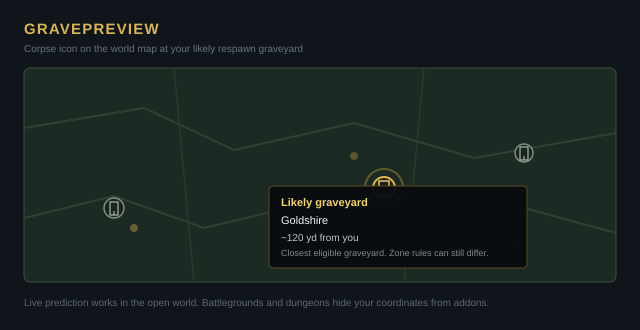

# GravePreview



A small World of Warcraft addon that puts a **corpse icon on the world map** at
the graveyard you are most likely to respawn at if you die at your current
location.

Open the map while questing and you immediately see where your ghost would end
up. Hover the icon for the graveyard name and the straight-line distance.

## What it shows

- A corpse icon on the **world map** at the closest eligible graveyard.
- A tooltip with:
  - the graveyard name,
  - the approximate distance from you,
  - a reminder that WoW's zone rules can still pick a different graveyard.

The icon follows you as you move: while the map is open it refreshes four times
per second.

## OpenMap

If you use **OpenMap**, GravePreview places the corpse icon on OpenMap's stitched
map through `OpenMapAPI.CanvasFromWorldPos()` and raises it above OpenMap's map
art. It switches to a normal Blizzard map pin when OpenMap is not stitched (for
example in dungeon maps or with OpenMap's stitched view off).

## How accurate is it?

WoW does not expose the server's hidden zone-to-graveyard table to addons.
GravePreview uses the closest **eligible** graveyard (the same `isGraveyardSelectable`
flag the default map uses) and labels the result as a likely spawn point. In
most open-world cases this is the graveyard you get; near zone borders or when
the server has special rules it can occasionally choose another one.

The addon only predicts while your position is available. WoW blocks player
coordinates in instances and battlegrounds, so there is no live prediction
there.

## Installation

Copy the `GravePreview` folder to:

```
World of Warcraft\_forever_\Interface\AddOns\GravePreview
```

The folder also contains `.toc` files for Classic Era and TBC Anniversary, so
the same folder works in:

```
World of Warcraft\_classic_era_\Interface\AddOns\GravePreview
World of Warcraft\_anniversary_\Interface\AddOns\GravePreview
```

Restart the client or `/reload`, and make sure **GravePreview** is enabled on
the character-select AddOns screen.

## Commands

```
/gpreview               Show command help
/gpreview on | off      Enable or disable
/gpreview update        Refresh the map pin now
/gpreview status        Print the current state
/gpreview debug         Print player position, map IDs and the chosen graveyard
```

`/gravepreview` is an alias.

## How it works

1. `UnitPosition("player")` gives your world position while outdoors.
2. A bundled dataset of 84 Forever 1.60.1 open-world spirit healer positions
   (`GravePreviewData.lua`) is searched first. This is the part that works
   while you are alive. Faction-specific entries are filtered against your
   faction. Within the current zone, a same-faction graveyard is preferred
   over a neutral one (Horde in Hillsbrad gets Tarren Mill, Alliance gets
   Southshore); neutral is used when there is no faction graveyard.
   If the bundled data has no entry for your continent, the addon falls back
   to `C_DeathInfo.GetGraveyardsForMap()` and then
   `C_WorldSafeLocsUIInternal.GetWorldSafeLocs()`.
3. The addon converts each graveyard to world coordinates with
   `C_Map.GetWorldPosFromMapPos()`, keeps the eligible ones, and picks the
   closest.
4. The winning graveyard is converted to the currently displayed map with
   `C_Map.GetMapPosFromWorldPos()` and shown through a `MapCanvasDataProviderMixin`
   pin, so it pans and zooms with the map.

The pin uses the same corpse texture as Blizzard's `CorpsePinTemplate`, with
client-specific texture coordinates for Classic-era and Forever.

## Limitations

- Open world only for live prediction. In instances/BGs the client returns no
  player coordinates to addons.
- The graveyard choice is the closest eligible one, not a guarantee. The server
  can use zone rules that are not exposed to addons.
- The distance is straight-line, not the actual run/travel distance.
- If the currently displayed map does not contain the predicted graveyard (for
  example you are looking at another continent), no icon is shown.

## Files

```
GravePreview/
  GravePreview.toc           Forever TOC
  GravePreview_Vanilla.toc   Classic Era TOC
  GravePreview_TBC.toc       TBC Anniversary TOC
  GravePreviewData.lua       Bundled spirit healer positions
  GravePreview.lua           Addon code
  GravePreview.xml           Map pin template
  README.md
  LICENSE                    MIT
  CURSEFORGE.md              Upload sheet
  CurseForge-logo.png        512x512 project avatar
  CurseForge-screenshot.png  1280x720 gallery image (PREVIEW mockup)
  tests/mock_test.lua        Offline smoke test (not loaded by WoW)
```

## Development

The Lua file is syntax-checked and smoke-tested with Lua 5.1 using the mock WoW
API in `tests/mock_test.lua`. The test file is not listed in any `.toc`, so the
game ignores it.
